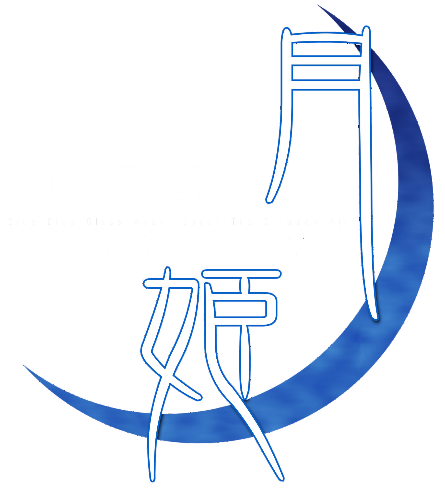

# Tsukihime PC port

A native Windows and Linux port of *TSUKIHIME -A piece of blue glass moon-*. It plays your own extracted PS4 game files directly, without converting them.

The **[setup guide](docs/SETUP_GUIDE.md)** covers everything in detail. Windows downloads include it as `SETUP_GUIDE.txt`, also on the launcher's Help & about page.

## Download and play

First get your game files: dump your own copy from your PS4, or extract your own `.pkg` backup, into a folder containing `eboot.bin`, `image/`, `data/` and `sce_sys/`. If you have the update, keep its folder next to the game folder.

### Windows

1. Download `Tsukihime-vX.Y.Z-win-x64.zip` from [Releases](https://github.com/Take00C/Tsukihime-Native-PC-Port/releases) and unzip it anywhere.
2. Start `TsukihimeLauncher.exe`.
3. On **Game files**, click **Browse…** and pick your game folder. The Ready check should turn all green.
4. Optional: choose your language, windowed or fullscreen, and create a desktop shortcut.
5. Press **PLAY**. Next time you can start `Tsukihime.exe` or the shortcut directly.

Everything it needs is included: no .NET, Python or emulator to install.

### Linux

1. Download `Tsukihime-vX.Y.Z-linux-x64.tar.gz` from [Releases](https://github.com/Take00C/Tsukihime-Native-PC-Port/releases) (v0.1.6 and newer).
2. Extract it and run `./Tsukihime` in the extracted folder.
3. Pick your game folder when it asks. If no folder window opens (no xdg-desktop-portal or zenity), run `./Tsukihime --game /path/to/CUSA47999` instead.

.NET, SDL and FFmpeg are included. There is no launcher on Linux; settings are in the pause menu. The **[Linux guide](docs/LINUX.md)** covers requirements and building from source.

### Updating

- **Windows:** press **Update to vX.Y.Z** at the bottom of the launcher (v0.1.3 and newer). From older versions, extract the new ZIP over your old folder.
- **Linux:** close the game, extract the new archive and run `./Tsukihime` in its new folder. Then delete the old folder.

Saves, settings and your game folder are kept: `%APPDATA%\Tsuki` on Windows, `~/.config/Tsuki` on Linux.

## Requirements

- Windows 10 or 11, 64-bit, or Linux x86-64.
- A graphics driver supporting OpenGL 3.3. Integrated graphics are supported.
- Your own extracted PS4 game files (`CUSA47999`, about 44 GB).
- About 260 MB for the Windows port, separate from the game files.
- On Linux, glibc 2.34 or newer. A source build also needs FFmpeg 9 shared libraries; the Linux guide lists them.

The game files are only read, never changed. The setup guide explains the supported folder layouts, including separate base-game and update folders.

## Features

- Japanese, English, Simplified Chinese and Traditional Chinese, according to the languages in your files.
- Original voices, music, sound effects and movies.
- 140 save slots with thumbnails, quick save/load, backlog voice replay and rewind.
- Auto and skip modes, flowchart, gallery and PS4 or shadPS4 save import.
- Keyboard, mouse, PlayStation and Xbox controller support with matching button prompts.
- Windowed or borderless fullscreen, remembered window size and F12 screenshots.
- Optional text output for dictionary tools through native text hooks, the clipboard or a local WebSocket feed.

## Screenshots

  
  
  
  
  
  

## Status and support

The port was developed against **CUSA47999, update 1.01**. Other builds are checked at startup and may be refused if required tables or files cannot be found. Only languages present in your game files are offered. Current source version is **0.1.6**. The Linux download is newer and less tested than the Windows one.

Report problems through Issues with reproduction steps and the relevant log. Include the build information and your operating system, graphics card and driver. See [CONTRIBUTING.md](CONTRIBUTING.md) for details. Do not attach game files, saves, story text or screenshots of the game.

## Documentation

- [Setup guide](docs/SETUP_GUIDE.md): game folders, controls, saves, settings, dictionary tools and troubleshooting.
- [Linux guide](docs/LINUX.md): dependencies, building, running and platform-specific checks.
- [Contributing](CONTRIBUTING.md): building from source, Python tools, tests and reporting problems.
- [Architecture](https://github.com/Take00C/Tsukihime-Native-PC-Port/blob/main/docs/ARCHITECTURE.md) and [format reference](https://github.com/Take00C/Tsukihime-Native-PC-Port/blob/main/docs/FORMATS.md): runtime components and engine research.
- [Publishing](https://github.com/Take00C/Tsukihime-Native-PC-Port/blob/main/docs/PUBLISHING.md): release preparation and personal icon builds.

## Credits and licence

Linux support and the shorter guides are by **CateDesu**. Menu code and effects include translations from [knife](https://github.com/AuroraWright/knife) by AuroraWright. The program uses FFmpeg, SDL3, .NET, Silk.NET, SDL3-CS and FFmpeg.AutoGen. Their credits, licences and translated-file notices are in [THIRD_PARTY.md](docs/THIRD_PARTY.md).

Source code is licensed under **MPL-2.0**. See [LICENSE](LICENSE).

This is an unofficial fan program, unaffiliated with TYPE-MOON, Aniplex, HuneX or Sony. TSUKIHIME and its assets belong to their rights holders. This program contains no game data and does not provide game files or links to sources of them. You must supply the files from your own copy.
