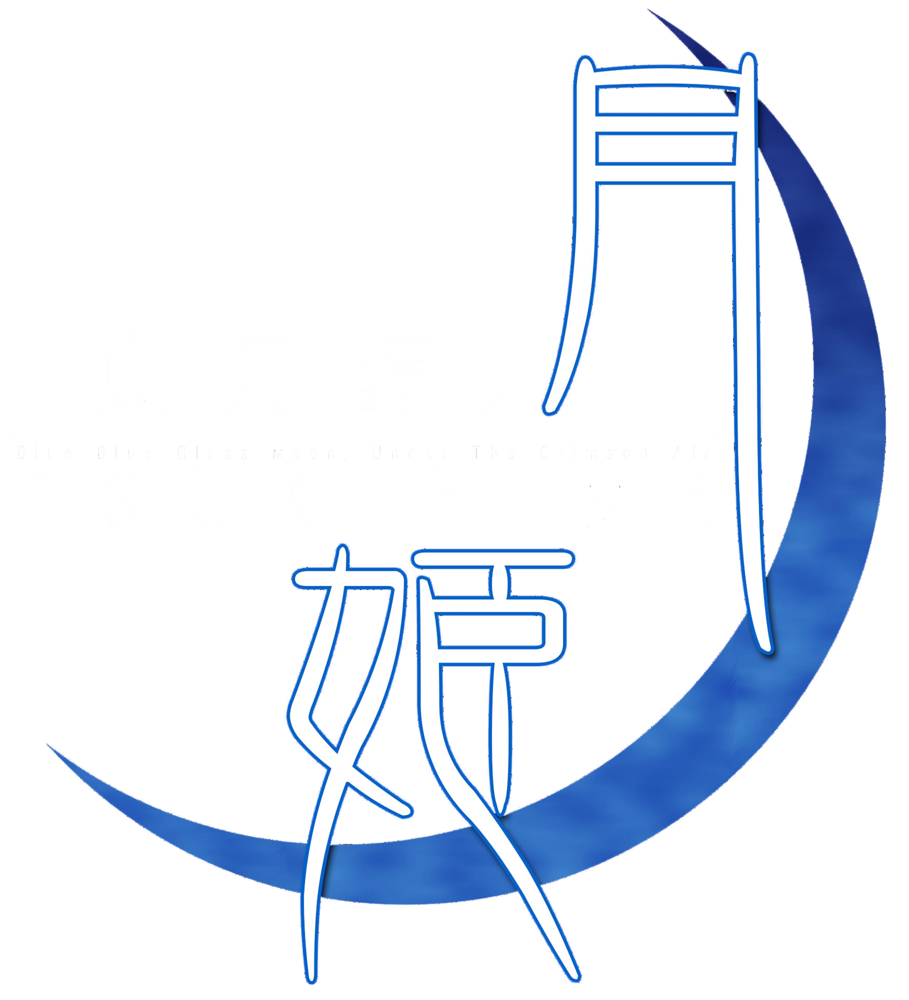

# Tsukihime PC port

A native Windows port of *TSUKIHIME -A piece of blue glass moon-*. It plays your own extracted PS4 game files directly, without converting them.

Start with the **[setup guide](docs/SETUP_GUIDE.md)**. Windows downloads include it as `SETUP_GUIDE.txt`, also available from the launcher's Help & about page.

## Download and play

### Windows

1. Download the Windows ZIP from [Releases](https://github.com/Take00C/Tsukihime-Native-PC-Port/releases).
2. Extract it and start `TsukihimeLauncher.exe`.
3. Choose your extracted game folder and press **PLAY**.

You can also start `Tsukihime.exe` directly. It asks for the game folder on first launch and remembers your choice. The Windows download includes the .NET runtime and native libraries. You do not need Python, a separate .NET installation or an emulator to play.

## Requirements

- Windows 10 or 11, 64-bit.
- A graphics driver supporting OpenGL 3.3. Integrated graphics are supported.
- Your own extracted PS4 game folder, `CUSA47999`, containing `eboot.bin`, `image/`, `data/` and `sce_sys/`. The game files take about 44 GB.
- About 260 MB for the Windows port, separate from the game files.

The setup guide explains supported folder layouts, including separate base-game and update folders. The program reads the game files without modifying them. Saves and settings are stored separately, and existing profiles keep their `Tsuki` folder name.

## Features

- Japanese, English, Simplified Chinese and Traditional Chinese, according to the languages in your files.
- Original voices, music, sound effects and movies.
- 140 save slots with thumbnails, quick save/load, backlog voice replay and rewind.
- Auto and skip modes, flowchart, gallery and PS4 or shadPS4 save import.
- Keyboard, mouse, PlayStation and Xbox controller support with matching button prompts.
- Windowed or borderless fullscreen, remembered window size and F12 screenshots.
- Optional text output for dictionary tools through native text hooks, the clipboard or a local WebSocket feed.

## Screenshots

  
  
  
  
  
  

## Status and support

The port was developed against **CUSA47999, update 1.01**. Other builds are checked at startup and may be refused if required tables or files cannot be found. Only languages present in your game files are offered. Current source version is **0.1.1**.

Report problems through Issues with reproduction steps and the relevant log. Include the build information and your operating system, graphics card and driver. See [CONTRIBUTING.md](CONTRIBUTING.md) for details. Do not attach game files, saves, story text or screenshots of the game.

## Documentation

- [Setup guide](docs/SETUP_GUIDE.md): game folders, controls, saves, settings, dictionary tools and troubleshooting.
- [Contributing](CONTRIBUTING.md): building from source, Python tools, tests and reporting problems.
- [Architecture](https://github.com/Take00C/Tsukihime-Native-PC-Port/blob/main/docs/ARCHITECTURE.md) and [format reference](https://github.com/Take00C/Tsukihime-Native-PC-Port/blob/main/docs/FORMATS.md): runtime components and engine research.
- [Publishing](https://github.com/Take00C/Tsukihime-Native-PC-Port/blob/main/docs/PUBLISHING.md): release preparation and personal icon builds.

## Credits and licence

Menu code and effects include translations from [knife](https://github.com/AuroraWright/knife) by AuroraWright. The program uses FFmpeg, SDL3, .NET, Silk.NET, SDL3-CS and FFmpeg.AutoGen. Their credits, licences and translated-file notices are in [THIRD_PARTY.md](docs/THIRD_PARTY.md).

Source code is licensed under **MPL-2.0**. See [LICENSE](LICENSE).

This is an unofficial fan program, unaffiliated with TYPE-MOON, Aniplex, HuneX or Sony. TSUKIHIME and its assets belong to their rights holders. This program contains no game data and does not provide game files or links to sources of them. You must supply the files from your own copy.
